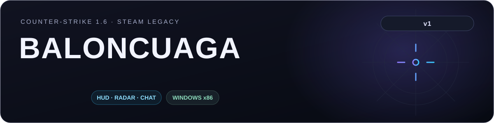

# BALONCUAGA v1

HUD для CS 1.6 Steam Legacy. Windows x86, OpenGL. Интерфейс на русском и английском.

[Скачать готовый HUD](https://github.com/fr3cy/BALONCUAGA/releases/latest/download/BALONCUAGA_v1_FULL.zip) · [Исходники](./source)

## Функции

- Модели ножа, HE, флешки и смока: смена в игре, обновление списка, 3D-предпросмотр.
- Настройка FOV.
- Прицел: статичный, динамичный и гибридный; размер, толщина, зазор, точка, цвет, контур и прозрачность.
- Текстурный 2D/3D-радар с настройкой масштаба и размера.
- Чат игроков, сервера и радио, история сообщений и фильтры.
- Спидометр, FOG и статистика Bhop / Duck / SGS.
- Showkeys и тренажёр колеса мыши.
- Плашка с ником, картой, FPS, пингом, скоростью и временем.
- Цвет дыма и ослепления от флешки.
- Темы меню, перемещение элементов, сохранение настроек и профилей.
- Отключение полос наблюдателя; после изменения нужен перезапуск игры.

## Установка

1. Закрой игру и сохрани копии старых файлов HUD и настроек.
2. Распакуй `BALONCUAGA_v1_FULL.zip` в папку Half-Life рядом с `hl.exe`.
3. Если раньше HUD стоял в `scripts`, убери оттуда старый `CS16Customizer.asi`. Свой `CS16Customizer.ini` перенеси в корень игры.
4. Запусти игру и нажми **Insert**.

Для запуска нужны `CS16Customizer.asi`, `version.dll` и `global.ini`. В комплектном `global.ini` задано `LoadFromScriptsOnly=0`. Уведомления о сторонних компонентах находятся в `THIRD_PARTY_NOTICES.txt`.

## Управление

| Клавиша | Действие |
| --- | --- |
| Insert | Открыть / закрыть меню |
| Y / U | Общий / командный чат при стандартных биндах |
| Колесо, Page Up / Page Down | Прокрутка открытого чата |
| F11 | Выгрузить HUD; для повторной загрузки перезапусти игру |

## Свои модели

Разложи модели GoldSrc MDL v10 по папкам:

```text
cstrike/models/customizer/knife/
cstrike/models/customizer/he/
cstrike/models/customizer/flash/
cstrike/models/customizer/smoke/
```

В меню выбери категорию, нажми «Обновить список», выбери модель и нажми «Применить». Если у модели есть файлы-компаньоны, положи их рядом с ней.

## Исходники и сборка

Код находится в [`source/`](./source), зависимости — в [`third_party/`](./third_party). Инструкция по сборке — [`BUILD_RU.txt`](./BUILD_RU.txt).

Для сборки нужны PowerShell и MinGW-w64 x86:

```powershell
./source/build.ps1 -Sdk ./third_party/halflife -MinHook ./third_party/minhook
```

Если компилятор отсутствует в PATH, передай каталог через `-BinDir`. Собранный `CS16Customizer.asi` появится рядом с папкой `source`.

## Примечания

- Для игры скачивай **FULL** из Releases. Автоматические архивы GitHub `Source code` — снимки репозитория выбранного тега.
- Метки игроков и чат используют сведения, полученные игровым клиентом.
- Перекраска нестандартного серверного дыма зависит от способа его отрисовки.
- Настройки сохраняются в `CS16Customizer.ini` рядом с ASI, профили — в `baloncuaga_configs`.
